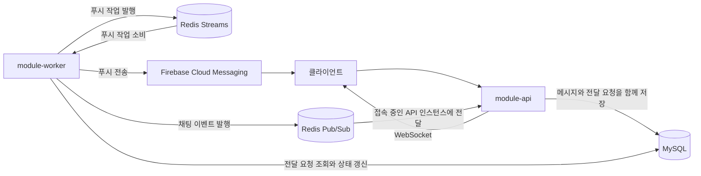

# 아키텍처 개요

## 실행 모듈

| 모듈 | 역할 | 주요 기술 |
| --- | --- | --- |
| `module-api` | HTTP API, WebSocket, 업무 처리, 메시지와 알림 요청 저장 | Spring MVC, JPA |
| `module-worker` | 채팅 전달, FCM 전송과 재시도 | Spring WebFlux, R2DBC, Redis |

## 메시지 저장과 실시간 전달

채팅 메시지와 브로드캐스트 요청은 같은 DB 트랜잭션에 기록합니다. 워커는 요청을 임대해 Redis Pub/Sub으로 발행하고, 발행에 실패하면 대기 시간을 늘려 재시도합니다. Redis 발행 뒤 완료 상태를 저장하기 전에 워커가 중단되면 같은 메시지가 다시 발행될 수 있으므로 클라이언트는 `messageId`로 중복을 제거해야 합니다.

## 재접속과 권한 확인

Redis Pub/Sub은 연결이 끊긴 구독자에게 이벤트를 보관하지 않습니다. 클라이언트는 재접속 후 WebSocket을 먼저 구독하고 `GET /api/chat/{roomId}/messages/page?afterMessageId=...`로 누락된 이력을 조회해야 합니다. 조회 결과와 실시간 이벤트는 `messageId` 기준으로 합칩니다.

같은 방에서 메시지 ID와 커밋 순서가 어긋나지 않도록 메시지 저장, 강퇴, 퇴장은 방 행 잠금으로 직렬화합니다. 이 잠금은 이력 재조회 커서의 누락을 막으므로, 변경하려면 대체 커서 설계와 동시성 검증이 필요합니다.

WebSocket으로 나가는 채팅 프레임마다 Redis에서 권한 revision을 확인하며 Redis 조회가 실패하면 전송을 막습니다. 이 확인을 캐시하면 강퇴와 퇴장 권한이 늦게 반영될 수 있으므로, 성능 개선은 부하 측정과 권한 변경 전파 보장을 함께 검토한 뒤 진행합니다.

## 푸시 알림

FCM 요청에는 재시도 동안 유지되는 `eventId`가 포함되며 채팅 알림에는 `messageId`도 포함됩니다. FCM이 요청을 수락한 뒤 응답만 유실되면 재시도로 같은 푸시가 다시 도착할 수 있으므로 클라이언트는 `eventId`와 `messageId`로 중복을 제거해야 합니다.

워커의 FCM 전송과 채팅 브로드캐스트는 `FCM_NOTIFICATIONS_ENABLED`, `CHAT_BROADCAST_WORKER_ENABLED`로 각각 제어합니다.
