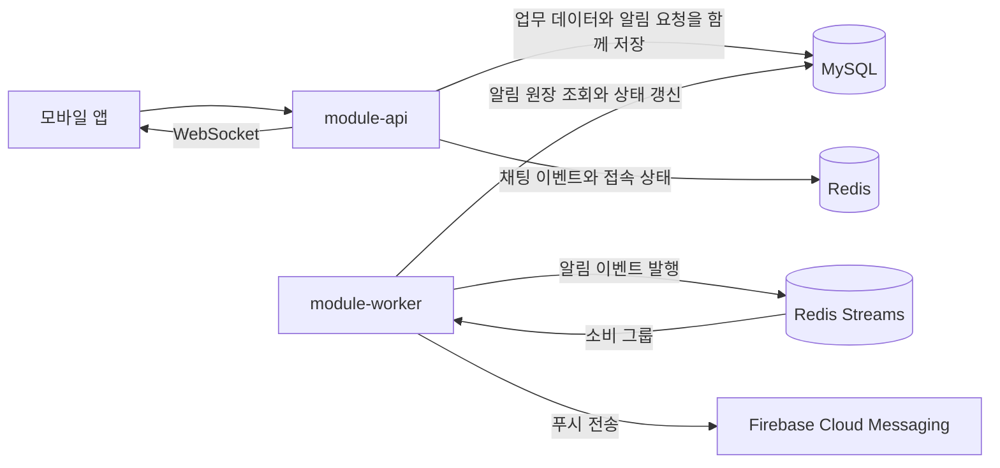

# 아키텍처 개요

Catxi는 사용자 요청을 처리하는 API와 알림을 전달하는 워커를 분리해 운영합니다. MySQL을 업무 데이터의 기준 저장소로 사용하고, Redis를 실시간 이벤트 전달에 사용합니다.

## 실행 모듈

| 모듈 | 책임 | 주요 구성 |
| --- | --- | --- |
| `module-api` | HTTP API, WebSocket, 업무 처리, 알림 요청 저장 | Spring MVC, JPA |
| `module-worker` | 알림 원장 처리, FCM 전송, 재시도와 실패 이력 | Spring WebFlux, R2DBC, Redis Streams |

## 데이터와 알림 흐름

업무 변경과 알림 요청은 MySQL의 같은 트랜잭션에서 저장합니다. 워커가 중단돼도 요청 원장은 남으며, 워커가 복구되면 처리를 이어갑니다. Redis Streams에서 처리 중인 항목도 재수거해 전송을 재시도합니다. 실패 이력 보존 기간은 기본 180일입니다.

## 채팅과 재접속

채팅 메시지는 MySQL에 저장합니다. Redis는 실시간 이벤트 전달과 접속 상태 관리에 사용합니다. 연결이 끊겼다가 다시 접속한 사용자는 마지막으로 확인한 메시지 ID 이후의 내용을 조회해 대화를 이어갈 수 있습니다.

## 운영 경계

API와 워커는 배포와 자원 규모를 독립적으로 조정할 수 있습니다. API의 DB 연결 풀과 워커의 R2DBC 풀은 각 인스턴스 수를 곱해 전체 연결 수를 산정해야 합니다. Redis Streams를 운영할 때는 Redis의 영속성과 메모리 정책도 함께 설정합니다.

환경 변수와 배포 절차는 [배포 안내](../../DEPLOYMENT.md)를, 메트릭과 로그 구성은 [모니터링 안내](../../monitoring/README.md)를 참고하세요.
