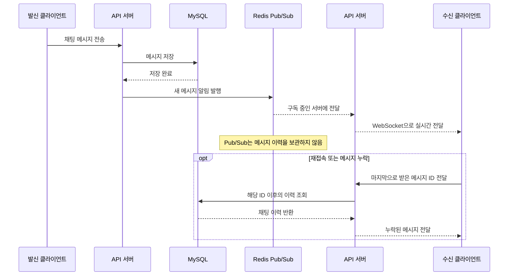

# 아키텍처 개요

Catxi는 사용자 요청을 처리하는 API와 푸시 알림을 전송하는 워커를 별도 실행 단위로 둡니다. 두 모듈은 같은 MySQL과 Redis를 사용하되 각자 필요한 접근 방식을 적용합니다.

## 모듈 구성

| 모듈 | 책임 | 주요 기술 |
| --- | --- | --- |
| `module-api` | REST, WebSocket, 회원, 매칭, 채팅, 위치와 알림 요청 처리 | Spring MVC, JPA, Redis |
| `module-worker` | 알림 이벤트 전달, Firebase 푸시 전송, 재시도와 실패 기록 관리 | Spring WebFlux, R2DBC, Redis Streams |
| `module-contract` | API와 워커 사이의 알림 이벤트 형식과 Redis 키 정의 | Java |

API와 워커는 같은 데이터베이스를 사용하지만 서로 다른 실행 파일로 빌드하고 배포합니다. API는 요청 처리와 트랜잭션에, 워커는 외부 알림 처리에 필요한 자원을 따로 조정할 수 있습니다.

## 푸시 알림 전달

알림 요청은 API가 업무 데이터와 함께 저장하고, 별도 실행되는 워커가 푸시를 전송합니다. 아래 그림은 요청을 저장한 시점부터 재시도와 실패 기록까지의 흐름을 보여 줍니다.

```mermaid
flowchart LR
    Client[클라이언트] --> API[API 서버]
    API -->|업무 데이터와 알림 요청을 함께 저장| DB[(MySQL)]

    subgraph Worker[알림 워커 (API 서버와 별도 실행)]
        Relay[미처리 알림 요청 전달]
        Consumer[푸시 알림 처리]
        Result{전송 결과}
        Retry[재시도 예약]
        Ack[처리 완료 확인]
        Consumer --> Result
        Result -->|성공| Ack
        Result -->|일시 오류| Retry
        Result -->|재시도 한도 초과| DB
    end

    DB -->|미처리 요청 조회| Relay
    Relay -->|메시지 발행| Stream[(Redis Stream)]
    Stream -->|소비자 그룹에 전달| Consumer
    Consumer -->|푸시 전송| FCM[Firebase Cloud Messaging]
    FCM -->|응답| Result
    Retry -->|다시 처리할 메시지 발행| Stream
    Ack -->|확인 및 삭제| Stream
```

API는 업무 데이터와 알림 요청을 같은 MySQL 트랜잭션으로 저장합니다. 워커는 알림 요청을 Redis Stream에 기록하고, 소비자 그룹이 메시지를 나눠 푸시를 보냅니다. Redis에 메시지를 발행하거나 Firebase로 전송하는 중 오류가 나면 재시도하며, 확인되지 않은 메시지는 다시 처리할 수 있습니다. Firebase 전송과 MySQL 기록은 하나의 트랜잭션으로 묶이지 않으므로, 전송이 성공한 직후 결과를 기록하기 전에 워커가 종료되면 같은 알림을 다시 보낼 수 있습니다. 재시도 한도를 넘긴 알림은 실패 내역으로 남습니다. 보존 기간은 [배포 안내](../../DEPLOYMENT.md)를 참고하세요.

## 채팅과 재접속

MySQL을 채팅 이력의 기준 저장소로 사용합니다. API 서버들은 Redis Pub/Sub로 새 메시지 알림을 주고받고, 연결된 클라이언트에는 WebSocket으로 메시지를 보냅니다. Pub/Sub는 오프라인 메시지를 보관하지 않으므로 재접속한 클라이언트는 마지막으로 받은 메시지 ID 이후의 이력을 MySQL에서 조회합니다.



## 인증 방식

인증 방식은 `CATXI_AUTH_MODE` 값 하나로 선택합니다. `kakao`는 카카오 계정으로 로그인하는 외부 인증(OAuth)을 사용합니다. 개발 프로필에서 `local`을 선택하면 `POST /api/members/signUp`과 `POST /api/members/login`에서 이메일과 비밀번호로 가입하고 로그인할 수 있습니다. 운영 프로필에서는 `local` 모드를 사용할 수 없습니다.

환경 변수와 배포 순서는 [배포 안내](../../DEPLOYMENT.md), 메트릭과 로그 수집 구성은 [모니터링 안내](../../monitoring/README.md)를 참고하세요.
