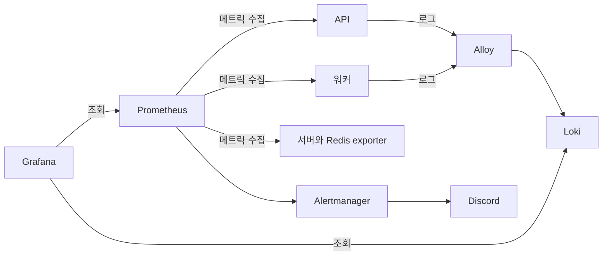

# 모니터링 안내

모니터링 Compose는 Prometheus로 메트릭을 수집하고 Grafana에서 조회합니다. Alloy가 애플리케이션 로그를 Loki로 보내며, Alertmanager는 경보를 Discord로 전달합니다.



## 서버별 설정

민감 정보와 서버 주소는 모니터링 서버의 `monitoring` 디렉터리에서 관리합니다. `.env`, `secrets/discord-webhook-url`, Prometheus 대상 파일은 Git에 올리지 않습니다.

```sh
cd monitoring
install -d -m 700 secrets
install -d -m 755 prometheus/targets
touch .env secrets/discord-webhook-url prometheus/targets/backend.yml prometheus/targets/worker.yml
chmod 600 .env secrets/discord-webhook-url
chmod 644 prometheus/targets/backend.yml prometheus/targets/worker.yml
```

`.env`에는 Grafana 관리자 암호와 비밀 키, Redis exporter 접속 정보를 넣습니다. Discord 웹훅 주소는 `secrets/discord-webhook-url` 파일에 저장합니다. 대상 파일에는 모니터링 서버에서 접근 가능한 API와 워커의 관리 주소를 지정합니다.

```yaml
- targets:
    - api.internal:8081
```

위 형식으로 `backend.yml`과 `worker.yml`을 각각 작성하세요. 예시 주소를 실제 사내 주소로 바꾸고, 관리 포트는 모니터링 서버에서만 접근 가능하게 제한합니다.

기본 포트는 API가 `8081`, 워커가 `8082`입니다. 포트를 바꿨다면 Compose 환경 파일의 관리 포트 값과 대상 파일을 함께 맞추세요.

애플리케이션과 모니터링이 다른 서버라면 기본 loopback 바인딩으로는 메트릭을 수집할 수 없습니다. 앱의 `MANAGEMENT_BIND_ADDRESS`와 `WORKER_MANAGEMENT_BIND_ADDRESS`를 사내 인터페이스에 지정하고, 방화벽에서 모니터링 서버만 허용하세요.

## 실행과 접근

`monitoring` 디렉터리에서 실행합니다.

```sh
docker compose config --quiet
docker compose up -d
docker compose ps
```

Grafana는 `http://127.0.0.1:3000`, Prometheus는 `http://127.0.0.1:9090`에서 확인할 수 있습니다. 서비스 포트는 기본적으로 로컬 인터페이스에만 열리므로, 사내 VPN이나 승인된 프록시 경로를 통해 접근하세요. 자세한 변수 이름과 기본값은 `monitoring/compose.yml`을 기준으로 관리합니다.
