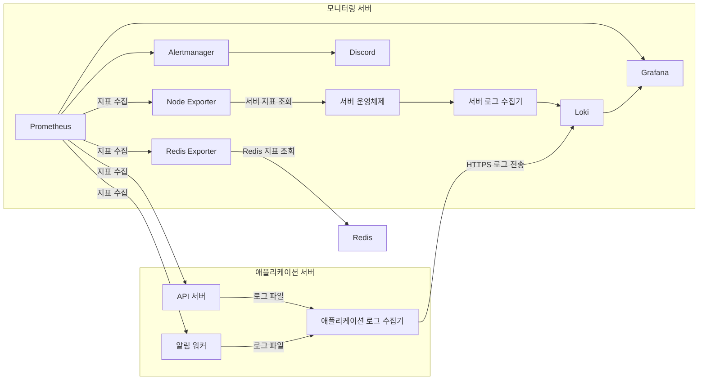

# 모니터링 구성

모니터링 구성은 API와 워커 배포와 분리해 실행합니다. Prometheus는 API와 워커, Redis, 모니터링 서버의 상태 지표를 모으고 Grafana에서 지표와 로그를 보여줍니다. Alertmanager는 경보를 Discord로 보냅니다. 로그 수집기 Alloy는 두 곳에서 실행합니다. 모니터링 서버의 Alloy는 서버 로그를, 애플리케이션 서버의 Alloy는 API와 워커 로그를 Loki로 보냅니다. 애플리케이션 로그 전송은 [배포 안내](../DEPLOYMENT.md)의 `log-shipping` 프로필을 사용합니다.



## 서버 설정과 실행

Docker Engine과 Docker Compose 플러그인 v2가 설치된 모니터링 서버에서 실행합니다. 환경 변수, 서버 주소와 Discord 웹훅은 운영 환경마다 다르므로 Git에 올리지 않고 서버의 `monitoring` 디렉터리에서 관리합니다. `.env`, `secrets/`, Prometheus 대상 설정은 저장소에서 제외합니다.

```sh
cd monitoring
mkdir -p prometheus/targets
umask 077
touch .env prometheus/targets/backend.yml prometheus/targets/worker.yml
chmod 600 .env prometheus/targets/backend.yml prometheus/targets/worker.yml
```

`.env`에는 `monitoring/compose.yml`에서 참조하는 Grafana 비밀번호와 비밀키, Redis Exporter 접속 정보를 직접 입력합니다. `backend.yml`에는 Prometheus가 접근할 API 관리 주소를 적고, 워커를 운영하면 `worker.yml`에도 워커 관리 주소를 적습니다. 워커를 운영하지 않으면 `worker.yml`에 빈 목록 `[]`을 작성합니다. Discord 경보를 사용하려면 `secrets/discord-webhook-url` 파일을 만들고 웹훅 주소를 저장합니다. 비밀 파일과 환경 파일은 소유자만 읽을 수 있도록 권한을 제한하세요.

대상 파일은 Prometheus의 파일 검색 형식으로 작성합니다. 아래 주소는 실제 사설 주소로 바꿉니다.

```yaml
- targets:
    - "api.internal:8081"
  labels:
    service: catxi-api
```

```sh
docker compose config --quiet
docker compose up -d
```

애플리케이션 지표는 `/actuator/prometheus`에서 수집합니다. API 관리 포트는 기본 8081이고 워커 관리 포트는 호스트의 8082입니다. 두 주소 모두 모니터링 서버에서 접근할 수 있는 사설 주소로 설정합니다.

## 접근 제한

Grafana, Prometheus, Alertmanager와 Loki는 기본적으로 루프백 주소에만 바인딩합니다. SSH 터널이나 접근 제어가 적용된 역방향 프록시를 사용하고, 애플리케이션의 관리 포트와 Redis Exporter 포트는 공개 인터넷에 열지 않습니다. Alloy에서 Loki로 로그를 보낼 때는 HTTPS와 전용 계정을 사용합니다.
